# Atividade Cache: cache LRU com TTL para conteúdos

API de conteúdos com um cache em memória na frente da busca por id. A busca sem cache simula uma consulta lenta (cerca de 2 s), e o cache tem quatro regras:

- **Limite de itens:** quando o cache está cheio, o item **menos usado recentemente (LRU)** é removido para dar lugar ao novo.
- **Expiração por TTL:** cada entrada vale por um tempo fixo; depois disso, a próxima busca vai ao banco de novo.
- **Invalidação no PUT:** ao atualizar um conteúdo, a entrada dele sai do cache, para que a próxima busca traga o dado novo.
- **Estatísticas:** acertos, falhas, remoções, tamanho atual e taxa de acerto ficam expostos em um endpoint.

## Endpoints

| Método | Rota                  | Descrição                                           |
|--------|-----------------------|-----------------------------------------------------|
| POST   | `/conteudos`          | Cadastra um conteúdo                                |
| GET    | `/conteudos/{id}`     | Busca um conteúdo (passa pelo cache)                |
| PUT    | `/conteudos/{id}`     | Atualiza um conteúdo e invalida a entrada no cache  |
| GET    | `/cache/estatisticas` | Retorna as estatísticas do cache                    |

Exemplo de corpo para `POST` e `PUT`:

```json
{
  "titulo": "Conteudo 4 ATUALIZADO",
  "corpo": "Texto novo do conteudo 4",
  "autor": "Breno"
}
```

## Configuração usada na demonstração

| Parâmetro                        | Valor            |
|----------------------------------|------------------|
| Limite do cache                  | 5 itens          |
| TTL                              | `<preencher>`    |
| Latência simulada sem cache      | ~2 s             |

## Como reproduzir

As requisições estão na coleção do Bruno **ATIVIDADE CACHE**, usando o ambiente `local` (variável `{{baseUrl}}`). Elas são numeradas e separadas em pastas na ordem da demonstração: Cadastro, Falha e acerto, Limite e remoção LRU, Expiração TTL, Invalidação no PUT e Estatísticas.

Basta rodar as requisições na ordem, com a aplicação recém-iniciada (cache vazio e estatísticas zeradas). Antes da pasta "Expiração TTL" é preciso esperar o TTL passar.

---

## Demonstração

Antes dos testes foram cadastrados os conteúdos de id 1 a 6 ("Conteudo 1" a "Conteudo 6", autor "Breno").

Como regra de leitura dos prints, olhe o tempo no canto superior direito da resposta: **~2 s é falha (MISS)**, a resposta veio do banco; **poucos ms é acerto (HIT)**, a resposta veio do cache.

### 1) A primeira busca de um conteúdo (MISS, lenta) e a segunda (HIT, rápida), comparando o tempo de resposta

| Req. | Rota                | Resultado | Tempo   |
|------|---------------------|-----------|---------|
| 08   | `GET /conteudos/1`  | MISS      | 2,03 s  |
| 09   | `GET /conteudos/1`  | HIT       | 6 ms    |

A primeira busca do id 1 vai ao banco e leva **2,03 s**; o resultado é guardado no cache. A segunda busca do mesmo id é servida da memória em **6 ms**, cerca de **340 vezes mais rápida**, com exatamente o mesmo conteúdo.

**Requisição 08: primeira busca do id 1 (MISS, 2,03 s)**

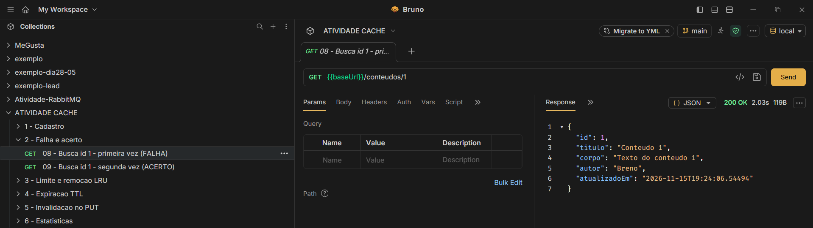

**Requisição 09: segunda busca do id 1 (HIT, 6 ms)**

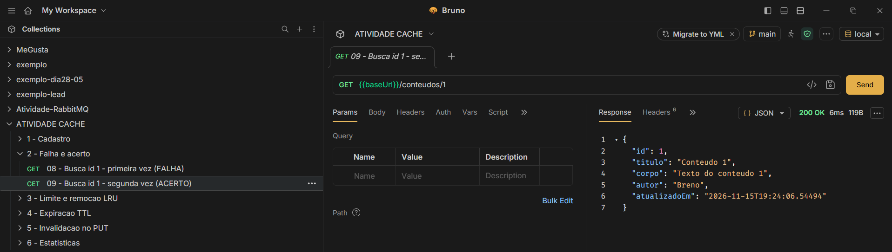

### 2) O cache atingindo o limite e removendo o item menos usado recentemente

| Req. | Rota               | Resultado | Tempo  | Cache depois (menos recente → mais recente) |
|------|--------------------|-----------|--------|---------------------------------------------|
| 10   | `GET /conteudos/2` | MISS      | 2,00 s | 1, 2                                        |
| 11   | `GET /conteudos/3` | MISS      | 2,01 s | 1, 2, 3                                     |
| 12   | `GET /conteudos/4` | MISS      | 2,00 s | 1, 2, 3, 4                                  |
| 13   | `GET /conteudos/5` | MISS      | 2,00 s | 1, 2, 3, 4, 5 (cheio)                       |
| 14   | `GET /conteudos/1` | MISS      | 2,01 s | 2, 3, 4, 5, 1                               |
| 15   | `GET /conteudos/6` | MISS      | 2,01 s | 3, 4, 5, 1, 6 (**remove o 2**)              |
| 16   | `GET /conteudos/2` | MISS      | 2,00 s | 4, 5, 1, 6, 2 (**remove o 3**)              |

As requisições 10 a 13 enchem o cache até o limite de 5 itens. A 14 acessa o id 1, que passa a ser o mais recente, e o id 2 vira o menos usado recentemente.

Na 15, o cache está cheio e o id 6 precisa entrar: o id 2, o menos recente, é removido. A 16 comprova a remoção: buscar o id 2 de novo leva 2,00 s (MISS), e para colocá-lo de volta o cache remove o próximo menos recente, o id 3.

> **Observação sobre a requisição 14:** ela foi planejada como acerto, mas levou 2,01 s, e as estatísticas finais confirmam que foi uma falha (ver item 5). O id 1 tinha entrado no cache na requisição 08 e o TTL dele venceu antes da 14, então a entrada expirada foi descartada e o conteúdo foi recarregado do banco. O efeito na ordem do cache é o mesmo (o id 1 vai para o fim da fila e o id 2 vira o menos recente), por isso a remoção do id 2 na requisição 15 acontece como esperado.

**Requisição 10: busca do id 2 (MISS)**

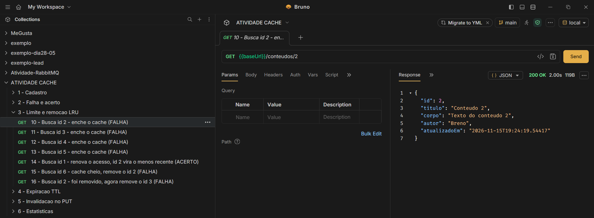

**Requisição 11: busca do id 3 (MISS)**

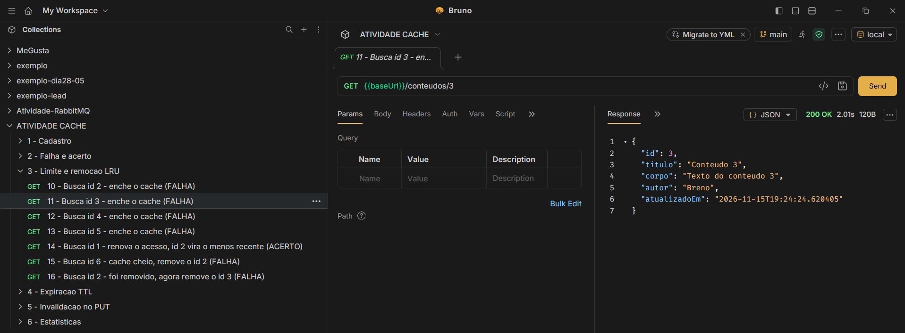

**Requisição 12: busca do id 4 (MISS)**

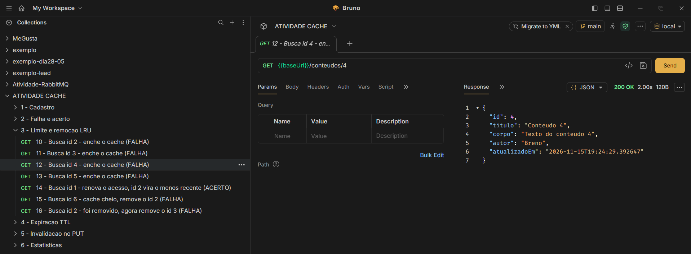

**Requisição 13: busca do id 5, cache atinge o limite de 5 itens (MISS)**

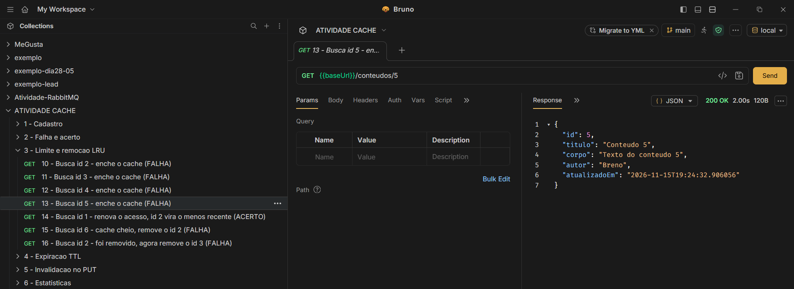

**Requisição 14: busca do id 1, que vira o mais recente**

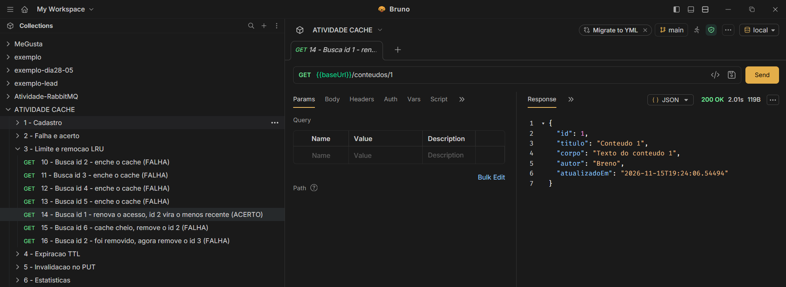

**Requisição 15: busca do id 6 com o cache cheio, remove o id 2 (MISS)**

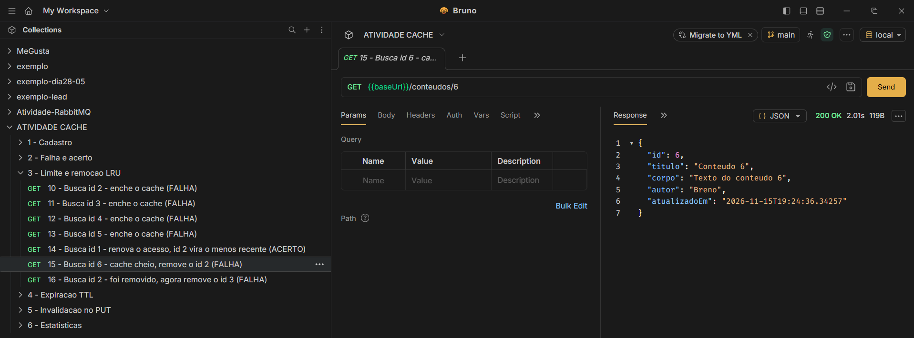

**Requisição 16: busca do id 2, que foi removido, volta a ser lenta (MISS, 2,00 s)**

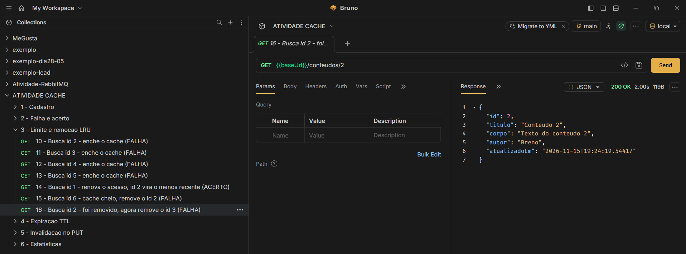

### 3) Um item expirando pelo TTL

| Req. | Rota               | Resultado | Tempo  |
|------|--------------------|-----------|--------|
| 17   | `GET /conteudos/1` | MISS      | 2,01 s |

O id 1 estava no cache desde a requisição 14 e nunca foi removido pelo LRU. Depois de esperar o TTL, a busca volta a levar **2,01 s**: a entrada expirou e o conteúdo foi lido do banco de novo.

**Requisição 17: busca do id 1 depois do TTL (MISS, 2,01 s)**

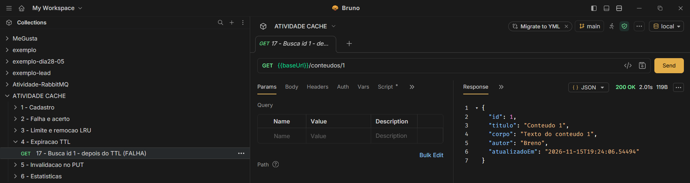

### 4) A invalidação após um PUT

| Req. | Rota               | Resultado      | Tempo  |
|------|--------------------|----------------|--------|
| 18   | `GET /conteudos/4` | MISS           | 2,01 s |
| 19   | `GET /conteudos/4` | HIT            | 4 ms   |
| 20   | `PUT /conteudos/4` | atualização    | 28 ms  |
| 21   | `GET /conteudos/4` | MISS           | 2,01 s |

A requisição 18 coloca o id 4 de volta no cache (a entrada antiga, da requisição 12, já tinha expirado) e a 19 confirma que ele está lá, respondendo em **4 ms** com o título "Conteudo 4".

A 20 atualiza o id 4 para "Conteudo 4 ATUALIZADO" e invalida a entrada no cache. Na 21, a busca volta a levar **2,01 s** (MISS) e já traz o título e o corpo novos. Sem a invalidação, a 21 seria um acerto e devolveria o conteúdo antigo.

**Requisição 18: busca do id 4, volta para o cache (MISS, 2,01 s)**

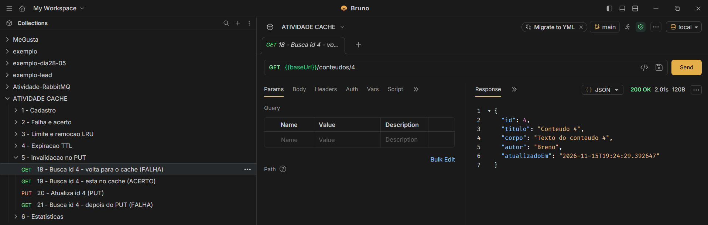

**Requisição 19: busca do id 4, está no cache (HIT, 4 ms)**

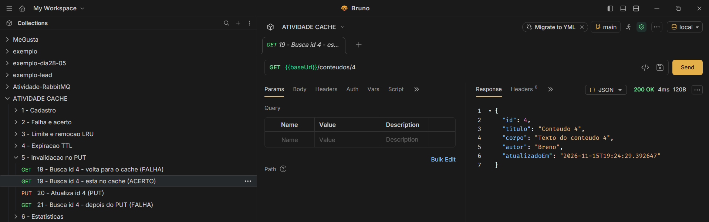

**Requisição 20: PUT atualizando o id 4**

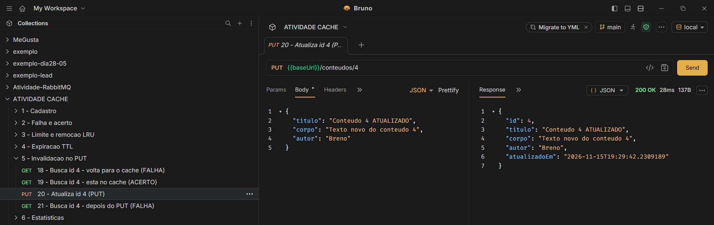

**Requisição 21: busca do id 4 depois do PUT, já com os dados novos (MISS, 2,01 s)**

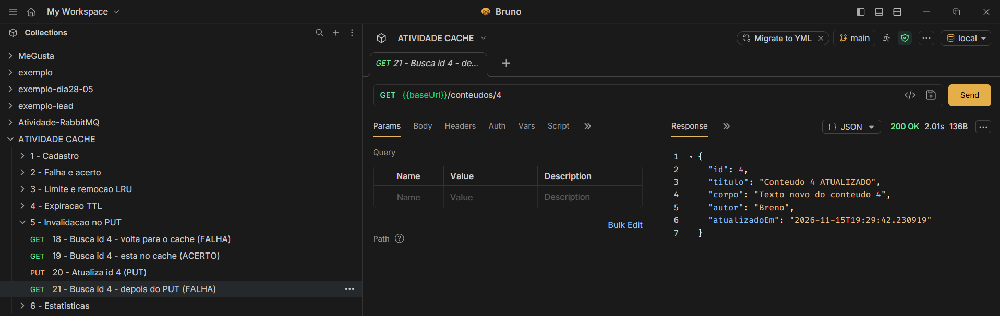

### 5) O endpoint de estatísticas ao final dos testes

`GET /cache/estatisticas`:

```json
{
  "tamanhoAtual": 5,
  "limite": 5,
  "acertos": 2,
  "falhas": 11,
  "remocoes": 2,
  "taxaDeAcerto": 0.15384615384615385
}
```

Conferência com as requisições feitas:

- **Buscas por id:** 13 (requisições 08 a 19 e 21, sem contar o PUT).
- **Acertos (2):** requisições 09 e 19.
- **Falhas (11):** requisições 08, 10, 11, 12, 13, 14, 15, 16, 17, 18 e 21.
- **Remoções (2):** as duas remoções por LRU, do id 2 (requisição 15) e do id 3 (requisição 16). Expirações por TTL e invalidações por PUT não entram nesse contador.
- **Taxa de acerto:** 2 / 13 = 0,1538.
- **Tamanho atual (5):** o cache terminou cheio, com os ids 5, 6, 2, 1 e 4.

**Requisição 22: estatísticas do cache**

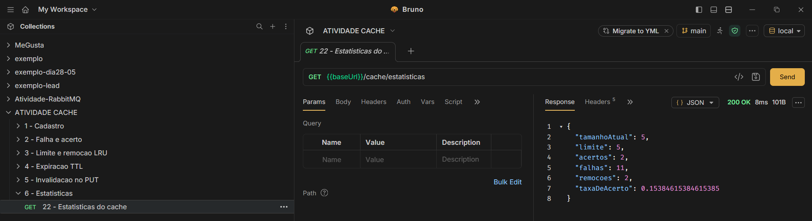